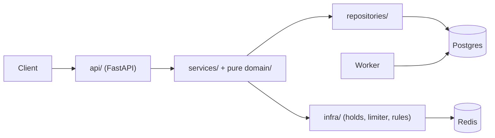
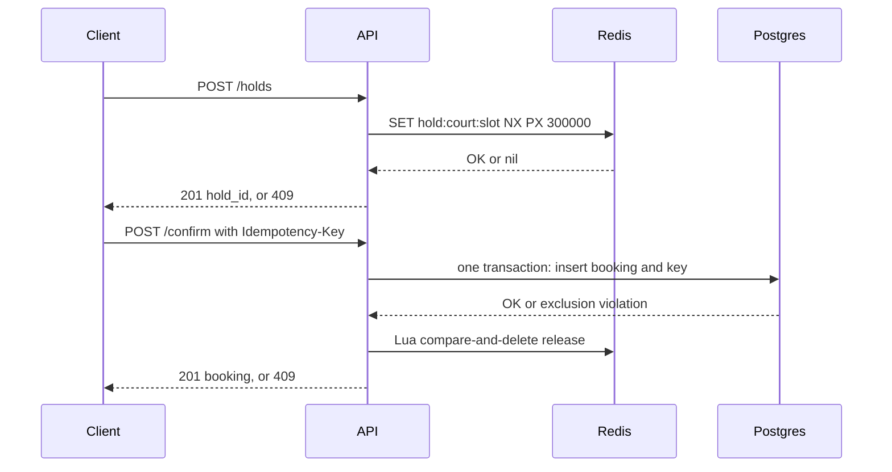

# SlotLock — SPEC.md

Source: supplied `SlotLock_ build scope.html`. Sections through Glossary preserve the supplied build scope; the final section records proposed implementation decisions separately.

One slot, one booking. A turf and court booking backend where a slot can never be double-booked, whichever channel or retry arrives first.

- 5 pm — **free**
- 6 pm — **booked**
- 7 pm — **booked**
- 8 pm — **held 5 min**
- 9 pm — **free**
- 10 pm — **free**

**Real user:** nearby turf and badminton-court owners who take bookings by call, WhatsApp and walk-in on a paper register plus WhatsApp. Groups clash over one slot and advances get disputed.

**Proves:** concurrency and correctness reasoning. **Does not prove:** async pipelines, AI, scale beyond one Postgres.

**Stack:** FastAPI, PostgreSQL, Redis, Docker, GitHub Actions (thin React/TypeScript UI only as stretch). **Limits:** 10 h/week for 4 weeks, shared kernel capped at 12 h, free tier or ≤ $10/month.

## Scope

### MVP

- Auth with rotating refresh tokens
- Venues, courts, staff
- Availability day grid
- Hold, confirm, cancel
- Versioned pricing and refund rules
- Idempotency-Key on writes
- Token-bucket limit on `/holds`
- RBAC plus ownership checks
- Keyset pagination
- Health, readiness, metrics
- Docker, CI/CD, VPS deploy, k6 results

### Stretch

- Recurring bookings
- UPI payment link for advances (store the UTR)
- Thin React/TypeScript UI

### Out of scope

- Kubernetes, Terraform, tracing, microservices
- AI: rules are deterministic, an LLM only adds latency and error
- Scale beyond one Postgres

## Roles and access

| Role | Can do |
| --- | --- |
| `OWNER` | Manage own venues, courts, staff and rules; see and cancel every booking of own venues. |
| `STAFF` | Scoped to one venue: book for walk-in, call and WhatsApp customers, cancel, view grid and bookings. |
| `CUSTOMER` | Browse, hold, confirm; view and cancel own bookings only. |

Implement as an RBAC dependency (`require_role`) plus an ownership check (venue scope for OWNER/STAFF, `user_id` for CUSTOMER) in services, never only in routers.

## Features

Auth and identity
:   Register, login, Argon2 hashing, short-lived JWT access token, rotating refresh token with reuse detection, logout.

Venue setup
:   Venues, courts (sport, slot length, opening hours), staff assignment.

Availability
:   Day grid per court: each slot FREE, HELD or BOOKED, with the price from rules.

Holds
:   5-minute Redis hold, early release, auto-expiry. Advisory only: it stops losers finding out late, it never decides truth.

Confirm
:   Postgres insert guarded by an exclusion constraint. A clash returns 409.

Channels
:   Each booking records `channel` (`app`, `call`, `whatsapp`, `walkin`). Staff book on behalf of a named customer (name and phone).

Cancel and refund
:   Rules decide the refund tier from time left before start; the slot is freed.

Rules engine
:   Versioned YAML; `decide(facts, ruleset)` returns outcome, reasons, rule\_version. Owners edit by publishing a new version.

Idempotency
:   Retries with the same `Idempotency-Key` return the first result.

Abuse control
:   Redis token bucket on `/holds` so bots cannot hoard slots; limits hold across replicas.

Platform
:   Problem+json errors, request-id in JSON logs, keyset pagination, Prometheus metrics, health and readiness probes.

## APIs

| Method | Path | Access | Notes |
| --- | --- | --- | --- |
| Auth | | | |
| POST | `/auth/register` | public | email, password, role (`CUSTOMER` or `OWNER`). 201. |
| POST | `/auth/login` | public | Returns access JWT (about 15 min) and refresh token. |
| POST | `/auth/refresh` | refresh token | Rotates. Reusing an old token revokes the whole family, 401. |
| POST | `/auth/logout` | any user | Revokes the refresh family. 204. |
| GET | `/me` | any user | Profile and role. |
| Venue setup | | | |
| POST | `/venues` | OWNER | name, address, timezone. 201. |
| GET | `/venues` | any user | Keyset-paginated list. |
| GET | `/venues/{venue_id}` | any user | Venue with its courts. |
| POST | `/venues/{venue_id}/courts` | OWNER of venue | name, sport, slot\_minutes, opening hours. |
| POST | `/venues/{venue_id}/staff` | OWNER of venue | Attach an existing user as STAFF. |
| Availability | | | |
| GET | `/courts/{court_id}/availability?date=YYYY-MM-DD` | any user | Day grid: FREE, HELD or BOOKED plus price per slot. |
| Holds (Redis) | | | |
| POST | `/holds` | any user, rate-limited | `{court_id, start, end}` returns 201 `{hold_id, expires_at, quote}`. 409 held or booked. 429 with `Retry-After`. |
| DELETE | `/holds/{hold_id}` | holder | Lua compare-and-delete. 204. |
| Bookings (Postgres) | | | |
| POST | `/confirm` | holder, or venue STAFF/OWNER | Header `Idempotency-Key` required. Body `{hold_id, channel, customer_name?, customer_phone?}`. 201 booking. 409 slot taken or duplicate in flight. 410 hold expired. 422 same key, different body. |
| GET | `/bookings` | CUSTOMER: own; STAFF/OWNER: venue | Filters venue\_id, court\_id, date, status. Keyset pagination. |
| GET | `/bookings/{booking_id}` | booking owner, venue STAFF/OWNER | Price, rule\_version, refund, channel. |
| POST | `/bookings/{booking_id}/cancel` | same as above | `Idempotency-Key` required. Rules decide refund; slot freed. |
| Rules | | | |
| GET | `/venues/{venue_id}/rules` | OWNER, STAFF | Active ruleset; `?version=n` for older ones. |
| POST | `/venues/{venue_id}/rules` | OWNER | Publish YAML as the next version after schema validation. |
| Ops | | | |
| GET | `/healthz` | public | Process is up. |
| GET | `/readyz` | public | Checks Postgres and Redis. Redis down: 200 with redis degraded. Postgres down: 503. |
| GET | `/metrics` | internal | Prometheus: holds, confirms, 409s, 429s, latency histograms. |

### Conventions

- Errors: `application/problem+json` with `type, title, status, detail, request_id`.
- Headers: `Authorization: Bearer`, `Idempotency-Key`, `X-Request-ID` (echoed and logged).
- Pagination: `?limit=&cursor=`, response carries `next_cursor` (keyset on `(created_at, id)`).
- Times are ISO 8601 with offset, stored as UTC. Money is integer paise. Slots align to the court’s `slot_minutes`.

## Flows





### Book a slot (any channel)

1. `GET availability` to pick a FREE slot.
2. `POST /holds`: token bucket check, price quote from rules, then `SET NX PX 300000`. A taken slot returns 409 immediately.
3. `POST /confirm`: one transaction takes an advisory lock on the key, checks the key, inserts the booking and the key with its response, commits.
4. Exclusion violation: roll back, return 409. After commit or failure, release the hold with the Lua script.
5. Staff and walk-ins use the same path with `channel` set and a customer name and phone.

### Race on one slot (the demo)

Two terminals hold and confirm the same slot: one gets 201, the other 409. Skip the hold or stop Redis and the result is the same, because the constraint is the truth.

### Cancel

1. Load the booking, check ownership or venue scope.
2. `decide(facts, ruleset)` with start time, now and amount paid, using the rule\_version saved on the booking.
3. Set `status=CANCELLED`, `refund_paise`, `cancelled_at`; log the reasons. The partial constraint frees the slot.

### Idempotent retry

1. Advisory lock fails (original still running): 409.
2. Key exists with a different request hash: 422.
3. Key exists with the same hash: replay the stored status and body.
4. No key: run the booking and store the response in the same transaction.

### Token refresh

Refresh marks the old token replaced and issues a new one in the same family. Presenting an already-replaced token revokes the family and returns 401.

### Redis outage

Holds and the limiter fail open, a log and metric fire, `/readyz` reports redis degraded. Correctness stays in Postgres.

### Publish a rule version

Owner posts YAML, schema validation runs, a new version is inserted and becomes active. Existing bookings keep their version.

## Data model

| Table | Key columns |
| --- | --- |
| `users` | id, email (unique), password\_hash, role, created\_at |
| `venues` | id, owner\_id, name, address, timezone |
| `venue_staff` | venue\_id, user\_id (primary key on both) |
| `courts` | id, venue\_id, name, sport, slot\_minutes, opens\_at, closes\_at |
| `bookings` | id, court\_id, user\_id, customer\_name, customer\_phone, `during tstzrange`, status (`CONFIRMED`/`CANCELLED`), channel, price\_paise, refund\_paise, rule\_version, created\_by, created\_at, cancelled\_at |
| `idempotency_keys` | user\_id, key, request\_hash, response\_code, response\_body, created\_at; `UNIQUE(user_id, key)` |
| `refresh_tokens` | id, user\_id, family\_id, token\_hash, expires\_at, revoked\_at, replaced\_by |
| `rulesets` | venue\_id, version, body (jsonb from YAML), published\_by, published\_at; primary key (venue\_id, version) |
| `payments` (stretch) | booking\_id, amount\_paise, utr, status |

```sql
CREATE EXTENSION IF NOT EXISTS btree_gist;
ALTER TABLE bookings ADD CONSTRAINT no_overlap
  EXCLUDE USING gist (court_id WITH =, during WITH &&)
  WHERE (status = 'CONFIRMED');
```

The `WHERE` clause lets a cancelled booking release its slot. Use a GiST index for availability reads.

## Redis and rules

- `hold:{court}:{slot}` holds the hold\_id, set with `SET … NX PX 300000`. Also store `hold:id:{hold_id}` as JSON (court, start, end, user) with the same TTL so `/confirm` can look it up.
- `rl:holds:{user_id}` is the token-bucket state.

```lua
-- release: delete only if the hold is still mine
if redis.call('GET', KEYS[1]) == ARGV[1] then return redis.call('DEL', KEYS[1]) end
return 0

-- token bucket: ARGV = capacity, refill per second, now (seconds)
local t = redis.call('HMGET', KEYS[1], 'tokens', 'ts')
local cap, rate, now = tonumber(ARGV[1]), tonumber(ARGV[2]), tonumber(ARGV[3])
local tokens = math.min(cap, (tonumber(t[1]) or cap) + (now - (tonumber(t[2]) or now)) * rate)
local ok = tokens >= 1
if ok then tokens = tokens - 1 end
redis.call('HSET', KEYS[1], 'tokens', tokens, 'ts', now)
redis.call('PEXPIRE', KEYS[1], 60000)
return ok and 1 or 0
```

Without Redis: losers learn only at confirm, bots hoard slots, and per-process limits fail at two or more replicas.

```yaml
version: 3
pricing:
  base_paise: 80000
  peak: {days: [fri, sat, sun], from: "18:00", to: "22:00", multiplier: 1.5}
cancellation:
  refund_tiers:
    - {hours_before: 24, refund_pct: 100}
    - {hours_before: 6, refund_pct: 50}
    - {hours_before: 0, refund_pct: 0}
```

`decide(facts, ruleset)` is a pure function in `domain/`: same input, same outcome. Log `rule_version` and reasons on every decision.

## Code structure

```text
app/
  core/          config (pydantic-settings), structlog + request-id, JWT, Argon2, problem+json
  domain/        pure logic, no I/O: slots, pricing, cancellation, decide()
  services/      auth, venues, availability, holds, bookings
  repositories/  Protocols + SQLAlchemy implementations (injected)
  api/           routers, deps: auth, RBAC, idempotency, pagination
  infra/         Redis client, idempotency, token-bucket limiter, rules engine
migrations/ k6/ tests/ Dockerfile compose.yml RESULTS.md README.md .env.example
```

## Ops and CI/CD

- Multi-stage, non-root Dockerfile built with uv. Compose runs api, worker, Postgres and Redis. The worker stays minimal in this project (for example purging old idempotency keys).
- k6 scripts (ES6+ modules) for availability, hold and confirm; record numbers in `RESULTS.md`. README has a Mermaid architecture diagram.
- GitHub Actions: ruff, mypy, pytest with Testcontainers (Postgres and Redis); on main build, push to GHCR, SSH-deploy to the VPS.
- Secrets live in GitHub and VPS env. Commit only `.env.example`.
- Alerts on 5xx rate and on 409 rate.

## Tests

- **Race:** N concurrent confirms for one slot give exactly one 201, the rest 409, zero overlapping rows. Runs in CI.
- **Idempotency:** injected retries create zero duplicates; changed body gives 422; in-flight duplicate gives 409.
- **Domain:** unit tests for pricing, refund tiers and `decide()` across rule versions.
- **Authz matrix:** every endpoint against OWNER, STAFF (own and other venue), CUSTOMER (own and other booking).
- **Redis down:** holds fail open and bookings still never overlap; `/readyz` shows degraded.
- **Auth:** refresh rotation and reuse revocation.

## Plan

| Week | Build | Done when |
| --- | --- | --- |
| 1 | Shared kernel (12 h cap) and auth. Start owner conversations. | Login and refresh work, CI green, compose boots, `/healthz` and `/readyz` respond. |
| 2 | Venues, courts, availability, confirm, cancel, exclusion constraint, idempotency, race tests. | Race test passes in CI. |
| 3 | Holds, Lua release, token bucket, rules in booking flow, metrics. | Two-terminal race demo works; `/metrics` scraped. |
| 4 | k6, `RESULTS.md`, VPS deploy, README with diagram. | Public URL up; 2-minute demo recorded; 3 owners have seen it. |

## Proof and interview

**Hardest decision:** the DB constraint is truth and Redis holds stay advisory. Lock expiry, GC pauses and failover can break lock-based exclusion (Redlock is disputed); a constraint cannot be bypassed.

**10x:** cache day grids (short TTL, bust on commit), add PgBouncer. **100x:** read replica, partition bookings by month; a hot Saturday-evening slot needs a waiting queue.

### Resume bullets (fill the brackets from your own measurements)

- Eliminated double-booking, measured by [0] overlaps in [N] concurrent confirms, by a Postgres exclusion constraint with advisory Redis holds.
- Made booking retry-safe, measured by [0] duplicates over [N] injected retries, by saving idempotency keys in the booking transaction.
- Held availability p95 at [X] ms at [Y] RPS on [spec], by GiST range indexes and a tuned pool.

### Interview answers

Why not SELECT then INSERT?
:   A race sits between the check and the write; the constraint is atomic across replicas.

Redis dies mid-hold?
:   Holds vanish, the DB stays correct; fail open and report readiness degraded.

Retried a timed-out confirm?
:   Key plus request hash replays the stored response; different body 422, in-flight duplicate 409.

### Glossary

Exclusion constraint on tstzrange
:   Postgres rejects any row whose time interval overlaps another row’s, atomically.

Idempotency key
:   A client token; a retry with the same token returns the first result instead of repeating the action.

Token bucket
:   A counter that refills at a fixed rate; each request spends one, an empty bucket means reject.

Redis Lua script
:   Code that runs atomically inside Redis, so check-then-delete cannot interleave with other clients.

Advisory lock
:   An app-defined Postgres lock on any key you choose.

UTR
:   The reference number on a UPI or bank credit, usually 12 digits; confirm on real statements.

## Implementation clarifications — proposed defaults, not original requirements

The following close gaps in the supplied scope. Record the adopted decisions and their rationale in PROGRESS.md before implementing; do not silently change the public contract. These defaults permit autonomous implementation without relaxing correctness. If a default conflicts with existing repository behavior or the supplied requirements, document the conflict and isolate that task.

| ID | Gap in source | Proposed implementation default |
| --- | --- | --- |
| D01 | Fail-open holds vs confirm body containing only `hold_id` | Make `hold_id` an opaque, signed, expiring token carrying court, interval, holder, quote and rule version. Use Redis for advisory reservation and lookup; during a confirmed Redis outage, validate the signature and expiry instead. When Redis is healthy, a normally acquired hold must still match Redis state. A valid degraded-mode token may remain usable after Redis recovers; the database constraint remains authoritative. A missing, forged, released or expired normal hold must never authorize a healthy-mode booking. Never accept an arbitrary user-supplied ID as authorization. |
| D02 | Slot duration and range boundaries | MVP holds one aligned slot at a time; validate opening hours and use nonempty half-open `[start,end)` PostgreSQL ranges so adjacent slots are legal. Validate timezone using IANA names, reject ambiguous/nonexistent local inputs unless explicitly disambiguated, persist UTC. |
| D03 | Idempotency replay after hold deletion | Check caller identity, scoped key and request hash before reading Redis. Hash canonical operation (method/path/body). Store successful responses and terminal domain conflicts in the same DB transaction where feasible; use a savepoint to handle exclusion violations before persisting a 409. Do not persist transient in-flight 409, outages or authentication failures as terminal results. Define and document retention, including its retry guarantee. |
| D04 | Refund amount vs payments being stretch | MVP calculates a refund quote, not a real payment or transfer. Use an explicitly documented simulated amount-paid convention (price as assumed paid); show this in the API docs and demo. Never claim funds were collected/refunded. Real UPI/payment verification remains stretch. |
| D05 | Rules activation and pricing | Select active rules by latest published version; create a documented initial ruleset for each venue (sample values from scope). Serialize version publication per venue. Freeze quoted price and rule version in the hold; use saved version for cancellation. Use decimal/integer calculations with a documented paise rounding policy. |
| D06 | Staff identity / assignment | Preserve STAFF as one-venue scoped. Enforce this in storage and service checks; do not silently convert an OWNER or transfer existing staff to another venue. Staff booking records creator separately from the customer identity; for unregistered customers preserve name/phone and prevent unrelated customers reading those bookings. |
| D07 | Redis atomicity and limiter | Create slot and reverse-index keys atomically with matched expiry (Lua or equivalent). Compare-and-delete both safely; a stale release cannot delete a replacement hold. Use configurable capacity/refill and choose TTL long enough to refill. Distinguish a real Redis outage from a normal missing key. |
| D08 | Cancellation concurrency | Lock the target row, authorize, and update once. A repeated cancellation with a different key must not issue a second refund; return the existing cancelled outcome. |
| D09 | Refresh rotation race | Store only refresh-token hashes; serialize family rotation, commit reuse revocation before returning 401; validate expiry and JWT claims. Document access-token logout semantics. |
| D10 | Source's time budget | Preserve the supplied four-week / 10 h per week plan and 12 h shared-kernel cap as planning guidance, not an excuse to skip tests. No paid resources or actual production deployment without owner approval. |

### Operational acceptance

- `BOOKED` wins over `HELD` when both are visible. Availability is advisory, never a promise of a successful confirm.
- Verify PostgreSQL overlap protection directly in integration tests (without relying on the Redis limiter or hold). Also exercise the public degraded-mode API with separately issued valid holds and distinct idempotency keys. A direct DB/service test bypass is not a new unauthenticated public endpoint.
- Validate configuration and migrations on a fresh DB. Use actual PostgreSQL and Redis for integration/race tests, not SQLite or mocks as substitutes for those guarantees.
- Source says VPS deploy and owner demos are MVP completion targets. If credentials, budget approval, external users or Docker privileges are unavailable, record them as blocked; implement and document deployment configuration locally where possible. Do not claim a deployment, real-user validation, or measured performance unless verified.
- Stretch work starts only on explicit user approval after MVP gates pass.
